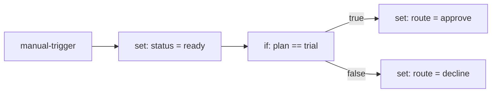

# How the engine works

This is the Stage 1 teach-back. By the end, you should be able to explain how one
JSON item moves from a trigger to a final output, why nodes use named output
ports, and why external effects go through engine ports. You should also be able
to explain why the tests use a simulation instead of a real clock and network.

The short version: **the engine is a deterministic queue. Each item visits one
node at a time, the node returns items on named output ports, and the engine
follows the matching connections.**

## What you will see

Run the triage example:

```sh
bun run cli -- run examples/triage.workflow.json --input examples/triage.input.json
```

The trace and final output look like this (`t` is elapsed milliseconds, and the
values vary):

```text
t=3ms     start        ok    1 item
t=3ms     enrich       ok    1 field
t=4ms     decide       ok    branch true
t=4ms     approve      ok    1 field
[
  {
    "customer": "Ada",
    "plan": "trial",
    "status": "ready",
    "route": "approve"
  }
]
```

The first four lines are the **trace**. Each line says which node ran, whether it
succeeded, and what it did. The JSON array is the list of final outputs: items
that reached an output port with no matching connection.

The workflow is a small graph:



The input is one item:

```json
{ "customer": "Ada", "plan": "trial" }
```

## Follow one item

1. The CLI reads the workflow and input files. `parseWorkflow` validates the raw
   JSON once at the boundary and gives each ID a branded type. A brand is a
   type-level tag, not a different string at runtime. From that point inward, the
   engine works with typed values instead of `unknown`.
2. The engine compiles each node's parameter expressions (whole-field
   [`{{ ... }}` values](../expressions.md)), then builds a node lookup, an
   outgoing-connection lookup, and an incoming count. A **start node** is any node
   with no incoming connection. If several nodes qualify, each one is a start
   node: the same initial item is queued for each, in node-ID order. The JSON
   array order is not execution order.
3. The engine puts the input item on the queue with `start`; here, `start` is the
   only start node. The queue is first-in, first-out, so the same graph and node
   results produce the same execution order.
4. For each queue entry, the engine evaluates that node's parameters against the
   current item and calls the node executor, the function that implements that
   node type. `manual-trigger` passes the item through on its `main` output port.
   `set` returns a new item with `status: "ready"`.
5. The engine has already evaluated `{{ $json.plan == 'trial' }}` to `true` before
   it calls IF. The IF node receives the boolean `true` and returns the item on its
   `true` output port. The engine matches that name to the connection from
   `decide` to `approve`, so the item is queued for `approve`.
6. `approve` adds `route: "approve"`. It has no outgoing connection, so the item
   becomes a final output. The `decline` node never runs for this input.
7. Every queue entry produces at least one trace line; each failed retry attempt
   adds its own line. If a node throws, the engine retries only errors that the
   node explicitly marks retryable. After the retries are exhausted, or
   immediately for a non-retryable error, it applies the node's
   [error policy](../error-routes.md). The step and queued-item limits stop
   runaway graphs instead of hanging.

An **output port** is a named output channel on a node. Successful nodes return
ordinary output ports such as `main`, `true`, or `false`. Every node also has an
engine-owned `error` output for routed failures. The engine does not guess what a
node means; it reads the ordinary output port names the node returns and follows
the connections that match each name. Because the node supplies the port name,
the IF node can branch without the engine knowing anything about IF. For a routed
failure, it creates the error item and sends it through the `error` output itself.
An **engine port** is different: it is an injected interface for an external
effect, such as time or HTTP.

## Why it is built this way

- **Parse once at the boundary.** The CLI parses untrusted JSON; the engine only
  sees a validated workflow. See
  [`packages/schema/src/workflow.ts`](../../packages/schema/src/workflow.ts) and
  [ADR 0013](../adr/0013-engine-execution-model.md) for the execution model.
- **Keep the engine pure.** The engine must not call `fetch`, call `Date.now`, use
  ambient timers, touch `process.env`, or log to the console. It reads time and
  makes HTTP requests only through the injected `Clock` and `Http` engine ports.
  The CLI supplies real implementations; tests supply fakes. See
  [ADR 0014](../adr/0014-http-request-and-retries.md) and
  [ADR 0015](../adr/0015-node-execution-timeouts.md).
- **Make the queue visible.** Every queue entry produces at least one trace line,
  and each failed retry attempt adds one. The deterministic queue makes a failing
  simulation reproducible. Step and queued-item limits make cycles and fan-out
  fail visibly.
- **Test behavior through fake engine ports, not heavy mocks.** Expect tests run
  the pure engine with fakes and snapshot the readable trace. Property tests
  generate many valid graphs and mutate valid graphs into invalid ones. See
  [ADR 0005](../adr/0005-test-strategy.md) and
  [ADR 0022](../adr/0022-property-tests-with-fast-check.md). A **simulation** is
  the engine plus fake engine ports: it runs the same code path without sleeping
  or opening a socket, so a property test can try many graphs in a few seconds.
- **Keep the trace honest.** A trace is a readable record returned by the engine.
  It is not yet the durable execution journal. Persistence, replay, and
  crash-and-resume belong to Stage 2 and later.

## What is not here yet

Stage 1 runs in one process and returns a trace. It does not persist anything.
The rows described in the [architecture overview](../architecture/overview.md)
for `executions` and `execution_journal`, the `RunStore` engine port, the worker,
and crash-and-resume are Stage 2 or later. The crash-and-resume test planned for
Stage 2 moves with that persistence work; it is not hiding inside the Stage 1
engine.

The API, editor, worker, database, and the `Random`, `Secrets`, and `RunStore`
engine ports are also not implemented. The engine has only the engine ports its
current consumers need.

## Try it

Take the false branch without editing the tracked example:

```sh
cp examples/triage.input.json /tmp/triage.input.json
```

Change `"plan": "trial"` to `"plan": "paid"` in `/tmp/triage.input.json`, then run:

```sh
bun run cli -- run examples/triage.workflow.json --input /tmp/triage.input.json
```

You should see `branch false` and `route: "decline"`.

Now open [`triage.test.ts`](../../packages/nodes-core/src/triage.test.ts) and change
`triageWorkflow(true)` to `triageWorkflow(false)` in the first test. Run:

```sh
bunx vitest run packages/nodes-core/src/triage.test.ts
```

The test should fail: both the inline trace snapshot and the final-output assertion
now disagree. That failure is the point: the trace is part of the test contract,
not just console output. Revert the change when you are done.

## Where the code is

- [`apps/cli/src/main.ts`](../../apps/cli/src/main.ts) — reads files, validates
  at the boundary, runs the workflow, and prints the trace and outputs.
- [`packages/schema/src/workflow.ts`](../../packages/schema/src/workflow.ts) —
  workflow validation and branded IDs.
- [`packages/engine/src/run.ts`](../../packages/engine/src/run.ts) — queue,
  scheduling, retries, timeouts, error policies, and trace creation.
- [`packages/engine/src/expression.ts`](../../packages/engine/src/expression.ts)
  — compiles and evaluates whole-field expressions per item.
- [`packages/engine/src/trace.ts`](../../packages/engine/src/trace.ts) — the trace
  shape and the terminal formatter.
- [`packages/engine/src/node.ts`](../../packages/engine/src/node.ts) — the node
  executor contract and runtime result validation.
- [`packages/engine/src/ports.ts`](../../packages/engine/src/ports.ts) — the
  `Clock` and `Http` engine ports.
- [`packages/nodes-core/src/index.ts`](../../packages/nodes-core/src/index.ts) —
  the built-in Manual Trigger, Set, IF, HTTP Request, Switch, Merge, and Loop
  executors.
- [`packages/nodes-core/src/triage.test.ts`](../../packages/nodes-core/src/triage.test.ts)
  — the readable expect test for this example.
- [`packages/engine/src/graph.property.test.ts`](../../packages/engine/src/graph.property.test.ts)
  — generated valid graphs and mutation-specific invalid graphs.

## Check yourself

You have the Stage 1 idea when you can answer these without looking:

1. Why does the engine start with every node that has no incoming connection,
   rather than the first node in the JSON array?
2. What does the IF node return, and how does the engine choose the `approve`
   connection?
3. Why can the same engine use a real clock in the CLI and a fake clock in a
   test?
4. Why is the trace not yet a journal?

The [glossary](../GLOSSARY.md) defines workflow, node, connection, item, output
port, engine port, trace, simulation, expect test, property test, and journal.
